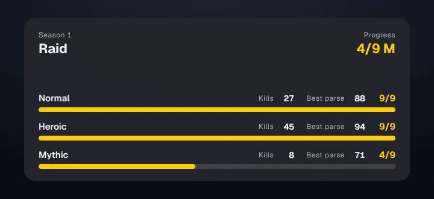
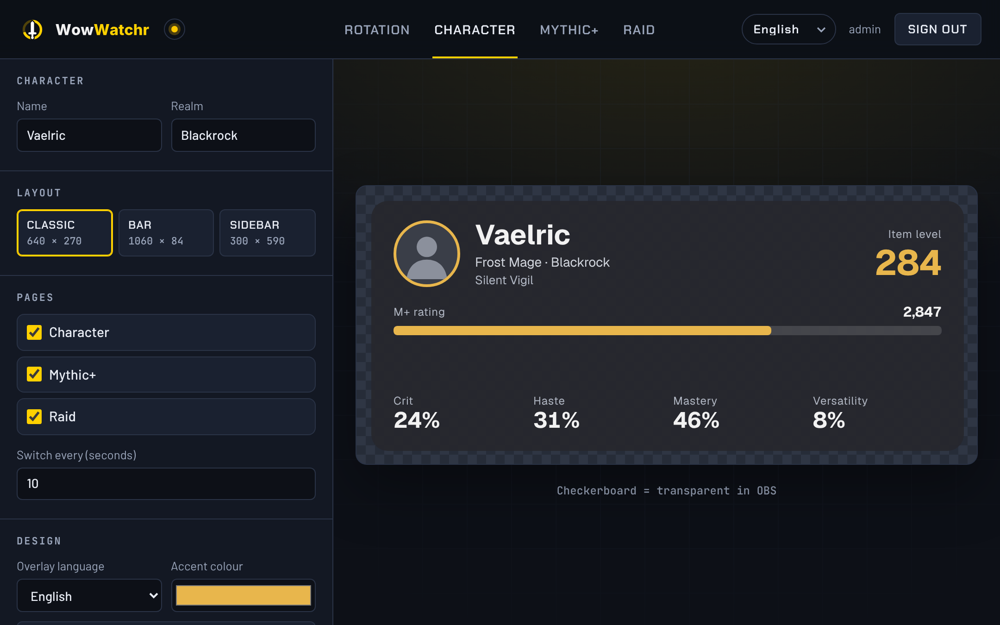
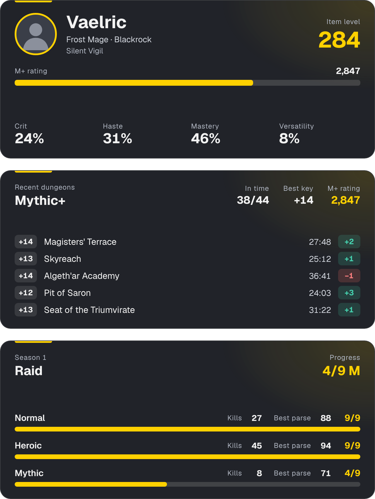
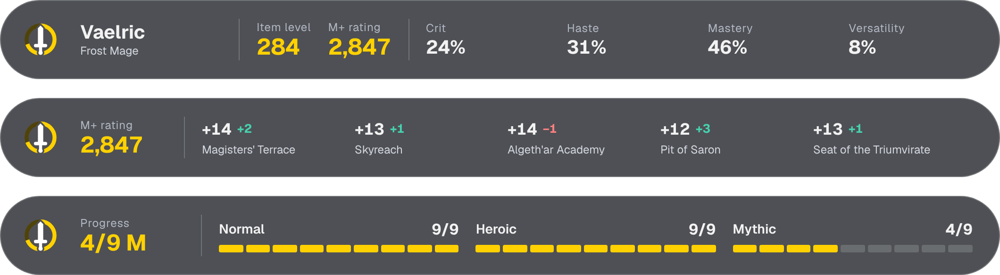
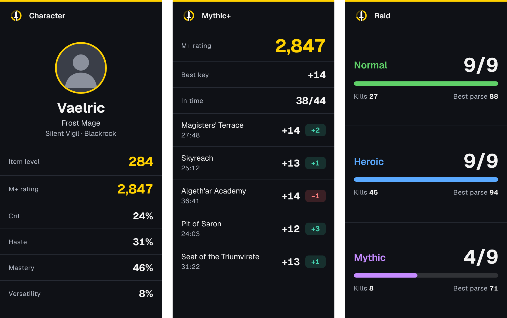

<h1>
  <picture>
    <source media="(prefers-color-scheme: dark)" srcset="public/logo-animated.svg">
    
  </picture>
</h1>

Show your **World of Warcraft** stats in your OBS stream: character, Mythic+ and raid progress, as a card, a slim bar or a sidebar. You host it yourself, design the overlay in the editor, and OBS shows it as a browser source.

<p align="center">
  
</p>

- Three pages: **Character** (item level, Mythic+ rating, secondary stats), **Mythic+** (rating, best timed key, dungeons timed this season, best runs) and **Raid** (progress and kills for Normal, Heroic and Mythic in the current raid)
- Three layouts: a **Classic** card, a slim **Bar** and a tall **Sidebar**
- One OBS URL that switches through the pages on its own, or one URL per page
- An editor in your browser with a live preview, protected by a login if you set a password, and every change shows up in OBS right away
- Real character data from the official Blizzard API, with your own free key
- Editor and overlay in English, German, Russian and French

## What it looks like

**Editor:** pick a layout, switch pages on or off, change the accent colour, character name or overlay language. The preview and OBS follow every change right away.



**Classic** (640 × 270): a card in the corner.



**Bar** (1060 × 84): a slim strip that covers little of the game.



**Sidebar** (300 × 590): a tall column beside the game.

<p align="center">
  
</p>

The screenshots show the sample data that the overlay uses until your Blizzard key is set up.

## Requirements

- [Node.js](https://nodejs.org) 22.13 or newer

## Setup and start

```bash
git clone https://github.com/Fersehet/WowWatchr.git
cd WowWatchr
npm install
cp .env.example .env   # Windows: copy .env.example .env
```

Set a password for the editor in `.env`:

```env
ADMIN_PASSWORD=a-long-password
```

If you leave `ADMIN_PASSWORD` empty, there is no sign-in and the editor opens right away. Only do that if nobody else can reach the server, because then anyone who can open the editor can change your overlay.

Then start it:

```bash
npm start
```

Open **http://localhost:3312** in your browser and sign in with user `admin` and your password (or go straight in, if you left the password empty). Enter your character name and realm in the editor and pick a layout.

## Real data

WowWatchr loads your character from the official Blizzard API. For that you need your own free Blizzard key. Without it, the overlay shows sample data.

1. Sign in at [develop.battle.net](https://develop.battle.net) with your Battle.net account.
2. Open **API Access** and click **Create Client**.
3. Name it `WowWatchr`, enter `http://localhost` as redirect URL, tick **I do not have a service URL for this client**, write a short intended use such as "Stats overlay for my own stream" and save.
4. Copy the **Client ID** and **Client Secret** into `.env`:

   ```env
   BLIZZARD_CLIENT_ID=your-client-id
   BLIZZARD_CLIENT_SECRET=your-client-secret
   ```

5. Restart the server. A new key can take up to 15 minutes to start working.
6. Type your character's **name**, **realm** and **region** into the editor. The status at the top of the editor shows whether real data is running.

The keys stay on your server; OBS and the overlay never see them. WowWatchr refreshes the data every five minutes. Blizzard updates a character when you log out, so new runs and kills show up after that. Best parses need Warcraft Logs and are not shown yet.

## Adding it to OBS

1. In the editor under **Add to OBS**, copy a URL, e.g. `http://localhost:3312/overlay`.
2. In OBS choose **Add source → Browser** and paste the URL.
3. Enter the width and height shown in the editor for your layout.

`/overlay` switches through the enabled pages on its own. `/overlay/character`, `/overlay/mplus` and `/overlay/raid` always show one page, if you would rather switch them yourself. If the server runs on another machine, use its IP instead of `localhost`. The overlay can be read without signing in. The editor needs the sign-in, unless `ADMIN_PASSWORD` is empty.

## Troubleshooting

- **The editor opens without asking for a password:** `ADMIN_PASSWORD` in `.env` is empty. Set one and restart the server. On Windows, make sure the file is called `.env` and not `.env.txt`.
- **"Too many attempts":** after 10 wrong passwords the login is locked for up to 15 minutes.
- **The overlay shows Vaelric from Blackrock and not my character:** that is the sample data. Check the status at the top of the editor and the three entries below.
- **"No Blizzard key":** put `BLIZZARD_CLIENT_ID` and `BLIZZARD_CLIENT_SECRET` into `.env` and restart the server.
- **"Blizzard unreachable":** a new key needs up to 15 minutes. If it stays, check both values in `.env` and look for "Blizzard" in the server log.
- **"Character not found":** check the spelling of the name (accents count), the realm and the region. A character that has not logged in for a long time can be missing at Blizzard until you log in and out once.
- **Nothing shows up in OBS:** open the OBS URL in your browser. If it stays empty there, copy the URL again from the editor under **Add to OBS**. If the server runs on another machine, use its IP instead of `localhost`.
- **The overlay is cut off in OBS:** set the width and height of the Browser source to the size of your layout: Classic 640 × 270, Bar 1060 × 84, Sidebar 300 × 590.
- **The overlay doesn't switch pages:** the switching URL only rotates through pages that are ticked under **Pages**, so tick at least two. The time per page is set under **Switch every (seconds)**.
- **Changes don't show up after an update:** an old server may still be running in the background and holding port `3312`. Close every terminal running `npm start` (or end the `node` processes), then run `npm start` once. If the port is used by something else, set another one, e.g. `PORT=3313` in `.env`.
- **`npm start` fails right away:** check `node --version`. WowWatchr needs Node.js 22.13 or newer.

## Updating

```bash
git pull
npm install
npm start
```

Your settings live in `data/` and are kept. More settings (port, login, Blizzard key) are listed in `.env.example`.

## License

[MIT](LICENSE). Fonts (Geist, Chakra Petch, Barlow, JetBrains Mono): [SIL Open Font License](public/fonts/OFL.txt).

WowWatchr is a fan project and is not affiliated with or endorsed by Blizzard Entertainment. World of Warcraft is a trademark of Blizzard Entertainment, Inc.
